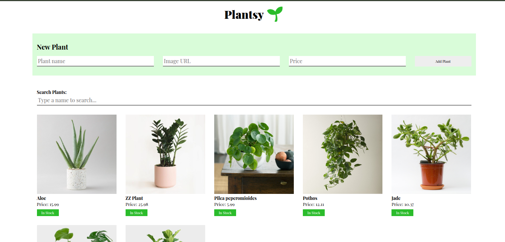

# Plantshop – React Plant Store

A React application for managing a plant shop. Users can view available plants, add new plants, update stock status, and search for plants by name.
## Application Screenshot




## Demo

Watch the application demonstration:


## Features

- **Display plants:** Fetch and display plants from the backend API when the application loads.
- **Add plants:** Add new plants using a form and save them through a POST request.
- **Stock management:** Toggle a plant between "In Stock" and "Out of Stock".
- **Search plants:** Search for plants by name using a live search filter.
- **React Hooks:** Use `useState` and `useEffect` to manage application state and API requests.

## Technologies Used

- React
- JavaScript
- Vite
- CSS
- JSON Server
- Vitest

## Installation and Setup

1. Clone the repository:

   ```bash
   git clone https://github.com/Tonny-web707/react-hooks-plantshop-cr-vite.git
   ```

2. Enter the project directory:

   ```bash
   cd react-hooks-plantshop-cr-vite
   ```

3. Install dependencies:

   ```bash
   npm install
   ```

4. Start the backend server in one terminal:

   ```bash
   npm run server
   ```

5. Start the React development server in another terminal:

   ```bash
   npm run dev
   ```

6. Open the application at:

   `http://localhost:5173`

The backend API is available at:

`http://localhost:6001/plants`

## API Endpoints

| Method | Endpoint | Description |
|---|---|---|
| GET | `/plants` | Retrieve all plants |
| POST | `/plants` | Add a new plant |

## Running Tests

Run the test suite with:

```bash
npm run test
```

All 10 tests pass across 5 test files.

## Learning Objectives

This project demonstrates:

- Managing state with React Hooks.
- Fetching data using the Fetch API.
- Using GET and POST requests.
- Handling form submissions.
- Passing data and functions through props.
- Filtering arrays using `filter()` and `includes()`.
- Working with Git branches and Pull Requests.

## Author

GitHub: [Tonny-web707](https://github.com/Tonny-web707)
